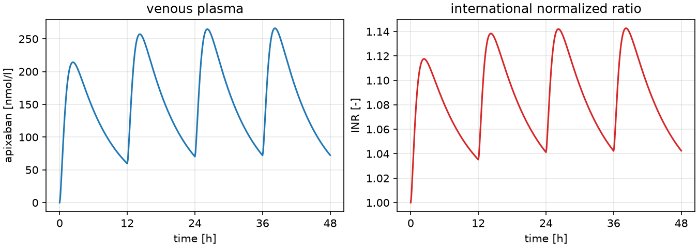

# Hybrid PK/PD: neural networks in mechanistic ODE models

[](https://github.com/matthiaskoenig/neural-ode/actions/workflows/sbml2jax.yml) [](https://matthiaskoenig.github.io/neural-ode/) [](installation.md) [](https://opensource.org/licenses/MIT)

This repository builds **hybrid PK/PD models**: mechanistic ordinary differential equation (ODE) models in which neural networks replace terms that are poorly known, also called universal differential equations ([Rackauckas *et al.* 2020](references.md#hybrid-models)). Everything is written in [JAX](https://github.com/jax-ml/jax), with [diffrax](https://github.com/patrick-kidger/diffrax) as ODE solver and [equinox](https://github.com/patrick-kidger/equinox) for the models, so a whole simulation is differentiable with respect to every parameter of the model and every weight of a network.

The application is the **apixaban PBPK/PD model** ([Myshkina *et al.* 2026](references.md#models)), a whole-body physiologically based model of the oral anticoagulant apixaban and its effect on coagulation. [libRoadRunner](https://libroadrunner.org) ([Welsh *et al.* 2023](references.md#simulation)) is the reference simulator of the mechanistic part, and the hybrid models are exchanged in the [PEtab SciML](https://petab-sciml.readthedocs.io) format. The source code is on [GitHub](https://github.com/matthiaskoenig/neural-ode).

It is the M.Sc. thesis of Tom Oberländer, supervised by Matthias König. Reproducibility and openness are design goals throughout: only open-source tools, public code and models, and every result can be regenerated from the repository.

!!! tip "New to the project?"
    See the [Roadmap](roadmap.md) for the work packages of the thesis, [install](installation.md) `sbml2jax` with pip or uv, and start with the [example below](#a-first-simulation). The [sbml2jax](sbml2jax/index.md) pages explain the conversion, the generated code and the simulation.

## A first simulation

`sbml2jax` converts the SBML model into a differentiable JAX model. This simulation gives 5 mg apixaban orally every 12 hours, follows the concentration in the venous plasma and its effect on the international normalized ratio (INR) for two days, and computes the gradient of the mean INR with respect to all 123 inputs of the model in one call:

```python
--8<-- "sbml2jax/examples/first_simulation.py:example"
```

```text
d mean(INR) / d Emax_INR     +7.112e-02
d mean(INR) / d EC50_api_INR -3.971e+01
d mean(INR) / d fu_api       -5.907e-01
```



`JaxModel.from_sbml` reads the SBML file, writes its ODE system as plain `jax.numpy` code and wraps it in an equinox module whose only array is the vector of inputs `p`, every number of the SBML model. Each `Segment` restarts the integration with a change, here a dose into the oral dosing state `PODOSE_api`. `simulate` returns all 257 outputs of the model (species, parameters, compartments and reaction rates) at the requested times, and `jax.grad` differentiates through the stiff ODE solver. [Simulation](sbml2jax/simulation.md) describes the segments, the solver settings and the gradients in detail.

The figure is written by `uv run python examples/first_simulation.py ../docs/images/first-simulation.png` in `sbml2jax/`, the code above is included from that script.

## Features

The project is a monorepo of self-contained Python packages, one per work package.

[sbml2jax](sbml2jax/index.md), the mechanistic baseline (work package 1):

- [Conversion](sbml2jax/conversion.md): the ODE system of an SBML model (species, compartments, reactions, rules, initial assignments, comp models, function definitions) as readable, differentiable JAX code.
- [Generated module](sbml2jax/generated-module.md): a plain Python file with `initial`, `rhs` and `outputs`, which can be versioned with the model and read like the equations.
- [Simulation](sbml2jax/simulation.md): `JaxModel` solves the system with diffrax, with dosing and other changes as segments, and `jax.grad` gives the gradient with respect to every number of the model.
- [Command line](sbml2jax/cli.md): `sbml2jax model.xml -o model.py` and the test suite runner `sbml2jax-testsuite`.

Verification:

- [Apixaban model](sbml2jax/apixaban.md): all 257 outputs of the whole-body model match libRoadRunner, and the gradients match finite differences.
- [SBML test suite](sbml2jax/testsuite.md): 998 of the 1823 cases pass, every converted model except two is simulated correctly.
- [Conversion issues](sbml2jax/conversion-issues.md): what is not supported yet, and why.

Next:

- [Hybrid models](hybrid/index.md): three placements of a neural network in the apixaban model, for the covariates, the effects and the absorption (work package 2).
- [Roadmap](roadmap.md): the work packages of the thesis, from the verified baseline to the PEtab SciML export.

The standards, tools and methods behind the project are cited in [References](references.md).

## How to cite

If you use this work please cite the repository:

> Oberländer, T. (2026). *Hybrid neural-network ODE models for PK/PD* (M.Sc. thesis, supervised by M. König) [Computer software]. https://github.com/matthiaskoenig/neural-ode

```bibtex
@software{oberlaender_hybrid_pkpd,
  author = {Oberländer, Tom},
  title  = {Hybrid neural-network ODE models for PK/PD},
  year   = {2026},
  url    = {https://github.com/matthiaskoenig/neural-ode},
  note   = {M.Sc. thesis, supervised by Matthias König},
}
```

Please also cite the apixaban model ([Myshkina *et al.* 2026](references.md#models), [doi:10.5281/zenodo.18877904](https://doi.org/10.5281/zenodo.18877904)) when you use it.

## License

The code is licensed under the [MIT License](https://opensource.org/licenses/MIT). The apixaban models in `sbml2jax/examples/models/` are copied unchanged from [apixaban-model](https://github.com/matthiaskoenig/apixaban-model) and keep their license, [CC BY-SA 4.0](https://creativecommons.org/licenses/by-sa/4.0/). `sbml2jax/src/sbml2jax/testsuite/cases.py` and `compare.py` are adapted from [sbml2cellml](https://github.com/matthiaskoenig/sbml2cellml) (MIT, Matthias König).
