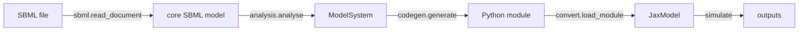

# sbml2jax

`sbml2jax` converts the ODE system of an [SBML](https://sbml.org) model ([Keating *et al.* 2020](../references.md#standards)) into a readable, differentiable [JAX](https://github.com/jax-ml/jax) module and simulates it with [diffrax](https://github.com/patrick-kidger/diffrax) ([Kidger 2021](../references.md#jax)). The model is an [equinox](https://github.com/patrick-kidger/equinox) module ([Kidger and Garcia 2021](../references.md#jax)), so `jax.grad` gives gradients with respect to every number of the SBML model, and neural networks can be added to its right-hand side ([Hybrid models](../hybrid/index.md)).

It is work package 1 of the thesis: the mechanistic baseline into which work package 2 puts neural networks. Its structure follows [sbml2cellml](https://github.com/matthiaskoenig/sbml2cellml), and [libRoadRunner](https://libroadrunner.org) is the reference simulator.

## Status

- **Apixaban PBPK/PD model** ([Myshkina *et al.* 2026](../references.md#models), flattened whole-body model, 51 states): all 257 outputs match roadrunner over a 24 h oral dose (relative 1e-5, absolute 1e-9), and the gradient of the plasma concentration agrees with finite differences, see [Apixaban model](apixaban.md).
- **SBML test suite** (3.5.0, all 1823 cases): 998 pass, 2 fail, 658 unsupported, 165 skip. Every model the converter accepts is simulated correctly except two cases with a parameter named `time`, which roadrunner fails as well, see [SBML test suite](testsuite.md). The unsupported cases use events, algebraic rules, delays, rateOf or rate rules of stoichiometries, see [Conversion issues](conversion-issues.md).

## The pipeline

1. [`sbml.read_document`](../api/sbml.md) reads the file with libsbml, flattens comp models and expands function definitions. Afterwards the model is core SBML.
2. [`analysis.analyse`](../api/analysis.md) assigns every identifier one role during the simulation, state, constant or computed, and collects their definitions, see [Conversion](conversion.md).
3. [`codegen.generate`](../api/codegen.md) writes the module with `initial`, `rhs` and `outputs`, each with only the definitions it needs in topological order, see [Generated module](generated-module.md).
4. [`model.JaxModel`](../api/model.md) wraps the module, holds the inputs and solves the system, see [Simulation](simulation.md).

[`convert.convert_sbml2jax`](../api/convert.md) runs steps 1 to 3, `JaxModel.from_sbml` all four.

## Design

- **Readable code.** The generated module is plain Python with `jax.numpy`, one assignment per quantity, named by its SBML id. It can be read like the equations of the model and versioned with it.
- **Gradients reach every number.** The values of the SBML attributes are the inputs `p` of the model. Initial assignments are evaluated in JAX from them, not by libsbml, so a gradient goes through them too.
- **No hidden state.** `JaxModel` is an immutable pytree; changing a parameter returns a new model.
- **Verified.** Every change is checked against roadrunner on the apixaban model and on the SBML test suite in CI.
